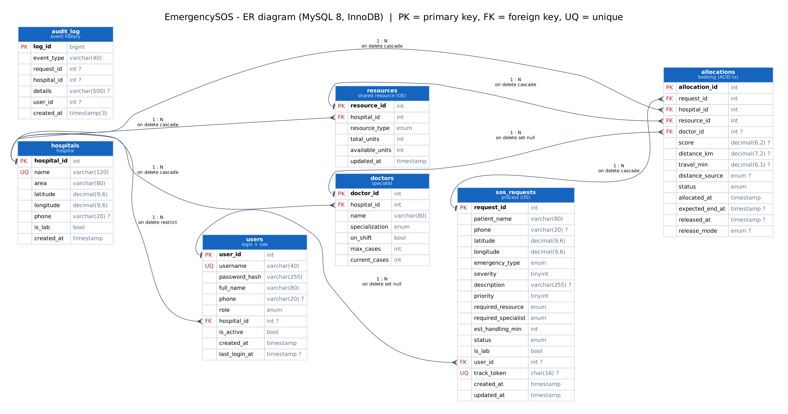

# EmergencySOS

**Team Rescuers · OSDBMS-V-2026-T203 · B.Tech CSE, Graphic Era (Deemed to be University)**

EmergencySOS routes an emergency (SOS) request to the most suitable hospital based on live bed, equipment and doctor availability. It combines two subjects:

| Subject | Idea | Where in the code |
|---|---|---|
| **Operating Systems** | SOS requests are *processes*; the dispatcher is the *CPU*; beds, ventilators and doctors are *shared resources*. The dispatcher works in **Automatic mode**: each patient goes into a Critical, Urgent or Routine queue, and each queue uses its own algorithm (**Priority with aging**, **SJF**, **FCFS**). All the algorithms are compared in the Scheduler Lab. | `scheduler.py` |
| **DBMS** | Hospital state lives in MySQL (InnoDB). Every reservation is an **ACID transaction** at **REPEATABLE READ**, using `SELECT ... FOR UPDATE` row locks for mutual exclusion, a fixed lock order against deadlocks, and rollback and retry. | `schema.sql`, `transaction_manager.py` |

Hospital names are real Dehradun-region hospitals with approximate locations. **All bed, equipment and doctor data is simulated.**

**Status: Phase III, 100% complete, plus the Tier 1 additions.** Login with roles, a hospital admin panel, road-distance routing with a live map, automatic case completion with live push updates, a mobile SOS portal, load testing and an ER diagram (Phase III); **ambulances as a second locked resource, Banker's algorithm on every admission, a live deadlock-detection lab, and database views, triggers and stored procedures** (Tier 1). 94 automated tests (see section 7).

---

## 1. Project structure

```
EmergencySOS/
├── schema.sql              # 8 tables, foreign keys, CHECK constraints, indexes
├── schema_objects.sql      # 5 views, 5 triggers, 2 stored procedures (loaded by init_db.py)
├── setup_mysql.py          # one-time: creates databases + an app MySQL user (no root needed after)
├── init_db.py              # creates the database and loads simulated data
├── config.py               # DB login, isolation level, aging interval, ranking weights
├── db.py                   # PyMySQL connection helpers + audit-log helper + change id for live updates
├── auth.py                 # login, password hashing, roles, @require_role, per-hospital access
├── admin_ops.py            # admin changes: hospitals, doctors, patients, users (all transactional)
├── routing.py              # road distance + travel time (OSRM), offline estimate fallback
├── classifier.py           # Emergency Classifier: type + severity -> priority, resource, specialist, burst
├── scheduler.py            # Automatic mode + Priority (aging), FCFS, SJF, MLQ + metrics + Gantt output
├── ranking.py              # weighted hospital scoring (road distance/units/specialist/load)
├── transaction_manager.py  # locking, commit/rollback, lock ordering, deadlock retry, release, auto-completion
├── bankers.py              # Banker's algorithm: safety + resource-request check before every admission
├── deadlock_lab.py         # deadlock demo: wait-for graph, cycle detection (DFS), InnoDB victim, retry
├── db_objects.py           # serves the views / triggers / procedures to the Database tab
├── concurrency_lab.py      # race demo: N clients vs 1 ICU bed, no locks / Python locks / stored procedure
├── load_test.py            # many concurrent clients + consistency check + isolation-level comparison
├── audit_log.py            # prints the latest audit-log events (terminal)
├── app.py                  # Flask REST API, login, live-update stream, auto-completion worker
├── templates/
│   ├── index.html          # staff console (dispatcher / hospital admin)
│   ├── login.html          # login page with the demo accounts
│   └── sos.html            # mobile-friendly SOS portal for patients
├── static/
│   ├── style.css, app.js       # console
│   ├── labs.js                 # console: Deadlock Lab and Database tabs
│   ├── portal.css, portal.js   # mobile portal
│   └── vendor/leaflet/         # map library, bundled so it works without a CDN
├── docs/
│   ├── er_diagram.png / .svg   # ER diagram, generated from the live database
│   └── make_er_diagram.py      # re-draws it: python docs/make_er_diagram.py
├── sample_workload.json    # the 12-request workload used in the report
├── test_core.py            # automated tests (94 tests)
└── requirements.txt
```

### Request flow

```
SOS form ──► Classifier ──► OS Scheduler ──► Ranking ──► Transaction Manager ──► MySQL
 (web or      (priority     (Priority/aging,  (40% ROAD    (lock, re-check,        (beds, doctors,
  mobile)      1-5, unit,    FCFS, SJF, MLQ)   distance,    commit / rollback)      allocations, log)
               specialist,                     25% units,        │
               burst)                          20% spec,         └─ unit gone? rollback → next hospital
                                               15% load)
                     case time over ──► auto-completion worker ──► same locked release transaction
       every change ──► audit_log row ──► change watcher ──► Server-Sent Events ──► all open screens refresh
```

### ER diagram



`audit_log` deliberately has **no foreign keys**: the history must survive even if a hospital or doctor row is deleted later.

---

## 2. Setup (do this once)

### 2.1 Install the software
1. **Python 3.10+**: https://www.python.org/downloads/ (on Windows, tick "Add Python to PATH").
2. **MySQL 8 Community Server**: https://dev.mysql.com/downloads/installer/. Remember the **root password** you set.
3. Make sure the MySQL service is running. On Windows, check Services → MySQL80 → Running.

### 2.2 Install the Python packages
Open a terminal in the `EmergencySOS` folder:

```bash
python -m venv venv
# Windows:
venv\Scripts\activate
# Linux / macOS:
source venv/bin/activate

pip install -r requirements.txt
```

### 2.3 Easiest: run the setup script
```bash
python setup_mysql.py
```
The script asks once for an admin login: root, or whoever can create users. With XAMPP, root has no password, so just press Enter. It then:
- creates the `emergencysos` and `emergencysos_test` databases
- creates an app user (`sos` by default) with rights on those two databases only
- saves that login to `db_login.json`, which `config.py` reads automatically
- allows the app user to create **triggers** (`log_bin_trust_function_creators = 1`). MySQL 8 has binary logging on, and then only an admin may allow this.

The admin password is never saved. After this, skip to 2.4.

> **Already ran setup before the triggers were added?** Run `python setup_mysql.py --triggers-only` once (it only asks for the admin login), then `python init_db.py`. Without it everything still works, but `init_db.py` prints a warning and skips the 5 triggers, and the Database tab shows a red banner.

### 2.3b Or set the login by hand
Either edit `config.py` (`DB_PASSWORD = os.environ.get("DB_PASSWORD", "your_password")`) **or** set an environment variable:

```bash
# Windows PowerShell
$env:DB_PASSWORD="your_password"
# Linux / macOS
export DB_PASSWORD=your_password
```

`DB_HOST`, `DB_PORT`, `DB_USER` and `DB_NAME` can be set the same way. The defaults are `localhost`, `3306`, `root` and `emergencysos`.

### 2.4 Create the database
```bash
python init_db.py
```
This creates the `emergencysos` database, all tables and the simulated data: 8 hospitals, 39 doctors, one hidden "Concurrency Lab Hospital" and four demo logins.
Run it again any time to reset everything. The **Reset simulated data** button (system admin) does the same.

> **Upgrading from Phase II?** The schema has new tables and columns, so run `python init_db.py` once after pulling.

### 2.5 Demo logins

| Username | Password | Role | Can do |
|---|---|---|---|
| `dispatcher` | `dispatch123` | Dispatcher | queue, dispatch, release, cancel requests, map, labs |
| `admin` | `admin123` | Hospital admin (system) | edit **every** hospital, add/delete hospitals, manage users, reset data |
| `maxadmin` | `admin123` | Hospital admin | edit **Max Super Speciality Hospital only** (others read-only) |
| `patient` | `patient123` | Patient | send SOS, follow own requests |

Passwords are stored as salted scrypt hashes, never as plain text. Change these accounts before any real use.
**Sending an SOS needs no login:** in an emergency nobody should be stopped by a login screen. An anonymous sender gets a private tracking link instead.

---

## 3. Run

```bash
python app.py
```
- Staff console: **http://127.0.0.1:5000** (log in)
- Patient SOS portal: **http://127.0.0.1:5000/sos**

**On a phone (same Wi-Fi):** start with `FLASK_HOST=0.0.0.0` (PowerShell: `$env:FLASK_HOST="0.0.0.0"; python app.py`), then open `http://<your-laptop-IP>:5000/sos` on the phone. Browsers only share GPS location over https or localhost, so on the phone over plain http tap the map or pick a place instead.

**Useful settings** (environment variables):

| Variable | Default | Meaning |
|---|---|---|
| `CASE_TIME_SCALE` | `1` | case length = handling time x this. **Use `0.1` for the demo** (a 13-min case finishes in ~1.3 min) |
| `AUTO_COMPLETE` | `1` | `0` turns automatic case completion off |
| `ROUTING_MODE` | `osrm` | `off` = never use the internet; road distance is estimated (straight line x 1.35) |
| `OSRM_URL` | public OSRM server | your own OSRM server, if you run one |
| `SECRET_KEY` | random, saved in `.secret_key` | signs the login cookie |

Run the tests (they use a separate `emergencysos_test` database, so demo data is safe):
```bash
python -m unittest -v test_core
```

Back-end tools (run in the terminal):
```bash
python scheduler.py         # prints the scheduler comparison for the sample workload
python concurrency_lab.py   # runs the race unlocked and locked
python load_test.py         # 20 concurrent clients x 15 SOS, for each isolation level, + consistency check
python audit_log.py         # latest 40 audit-log events (python audit_log.py 100 for more)
python docs/make_er_diagram.py   # re-draws the ER diagram from the database (needs Graphviz)
```

---

## 4. Demo script (for the evaluation)

Start with `CASE_TIME_SCALE=0.1` so automatic completion is visible within a minute or two. Use two browser windows side by side (or a window plus a phone).

1. **Login and roles**: open http://127.0.0.1:5000 and you are sent to the login page. Log in as `dispatcher`. Point out that the Users tab is missing, and that hospital numbers are read-only for a dispatcher.
2. **Mobile SOS portal**: in the second window (or phone) open `/sos` with **no login**. Tap *Cardiac*, severity *5*, pick a place, enter a name, then **SEND SOS**. The portal shows "Help request received", its queue position, and that it is in the Critical queue.
3. **Live push**: the dispatcher's top bar ("Pending") and Queue tab update **by themselves** within a second. Nothing polls: the server pushes a Server-Sent Event when anything changes (green **LIVE** dot).
4. **Queue tab**: click **Add demo requests**. Six requests appear that "arrived" 1–45 minutes ago, with their queue (Critical / Urgent / Routine), the algorithm used, and **aged** tags.
5. **Dispatch next** (SOS & Dispatch tab): the result shows *Chosen by* (queue + algorithm and why), the hospital, doctor, **road distance and drive time** (tag *road*, or *estimate* when offline), the ranking table and the transaction attempts. The portal window flips to **Hospital assigned** with a call button and the route on a map, again by itself.
6. **Map tab**: hospitals (number = free ICU beds), waiting patients coloured by priority, and every active case drawn along its **road route**.
7. **Automatic completion**: the *Auto-completes* column counts down. At 0 the worker releases the case with the same locked transaction as the Release button; the bed returns and the audit log shows `AUTO_COMPLETED`.
8. **Admin**: log out, log in as `maxadmin`. Only **Max Super Speciality Hospital** is editable. Add a doctor, edit hospital details, set ICU free beds to 0. Then trying to delete a doctor who has an open case is **refused** by the transaction's business rule. Log in as `admin` (system admin): all hospitals are editable, plus **Add hospital** and the **Users** tab (create an account, disable one; a disabled user is logged out immediately).
9. **Admin changes affect routing**: with Max's ICU at 0, dispatch another cardiac case and Max drops out of the ranking.
10. **Patients**: on *Queue & Patients*, **Edit** fixes a patient's name or phone; **Cancel** (dispatcher) removes a waiting request.
11. **Audit log tab**: every SOS, allocation, rollback, release, auto-completion, admin change and login, with **who** did it.
12. **Scheduler Lab**: choose **Sample workload** and click **Run comparison**. Expected numbers:

   | Policy | Avg wait | Avg turnaround | Critical (P1–P2) wait | Max wait |
   |---|---|---|---|---|
   | Automatic (smart queues) | 24.92 | 34.50 | 18.75 | 79 |
   | Priority with aging | 24.92 | 34.50 | **18.75** | 79 |
   | Priority (no aging) | 25.92 | 35.50 | 12.75 | 80 |
   | FCFS | 25.33 | 34.92 | **27.88** | 59 |
   | SJF | 23.92 | 33.50 | 22.62 | 65 |
   | Multilevel Queue | 25.92 | 35.50 | 12.75 | 80 |

   Talking point: aging trades a little critical-patient wait (12.75 → 18.75) for fairness. The longest wait drops and low-priority requests cannot starve.
13. **Concurrency race (terminal)**: `python concurrency_lab.py`. The unlocked run gives 6 bookings for 1 bed (INCONSISTENT); the locked run gives exactly 1 booking and 5 rollbacks.
14. **Load test (terminal)**: `python load_test.py`. 20 clients hit the database at once for each isolation level; the table shows throughput, latency, stale-ranking fallbacks and retries, and **CONSISTENT: YES** for every level.

**Tier 1 additions (OS + DBMS depth)**

15. **Ambulances**: the top bar shows *Free amb.*; after a dispatch the result says *Ambulance: sent from the hospital, N left there, back in ~M min*, and the Active allocations table counts the ambulance's way back separately from the case. Set a hospital's ambulances to 0 free (Hospitals tab) and it drops out of the ranking even though it has beds: the bed and the ambulance are taken together or not at all (**no hold-and-wait**).
16. **Banker's algorithm** (*Deadlock Lab* tab): pick a hospital with active cases and a waiting patient, **Run safety check**. Show the Allocation / Max / Need matrices, the Available vector and the **safe sequence**, step by step. Then open *What if fewer units were free?*, set ICU beds and Ventilators to 0 and run again: **UNSAFE**, the cases that can never finish are marked. Every real dispatch runs the same check (see *Banker's check* in the dispatch result; an unsafe hospital shows as *Banker's: unsafe - rolled back* and the next one is tried).
17. **Deadlock detection** (*Deadlock Lab*): **Opposite lock order** runs two real MySQL transactions that each hold one row and wait for the other. The wait-for graph turns red (**cycle T1 → T2 → T1**), InnoDB picks a victim (error 1213), the other commits and the victim is retried. **Global lock order** runs the same two transactions in the project's lock order: one just waits, no cycle. Terminal version: `python deadlock_lab.py`.
18. **Race through a stored procedure** (*Deadlock Lab*): **No locks** gives 6 bookings for 1 bed; **Locked (stored procedure)** books exactly once with the same lock order, written entirely in SQL (`sp_allocate_unit`).
19. **Database tab**: the 5 views (click **Show rows**; open **SQL** to show the code), **Try an illegal status change** (the trigger refuses `COMPLETED -> PENDING` and the history table shows every legal step), **CALL sp_hospital_report** (one call, two result sets), and the status history of any request (written only by triggers).

## 5. Key design decisions

**Ambulances** (`transaction_manager.py`, `schema.sql`)
- A resource type `AMBULANCE` per hospital (its fleet counter). A case takes one unit of its care type **and** one ambulance inside the same transaction; if either is missing it rolls back and the next hospital is tried. Holding one while waiting for the other is impossible, so the *hold and wait* condition for deadlock never occurs.
- The ambulance comes back after the round trip (2 × drive time × `CASE_TIME_SCALE`), long before the bed; the auto-completion worker frees it (`AMBULANCE_BACK` in the audit log). Releasing a case early returns an ambulance still on the road.
- Global lock order: request → hospital → care unit → doctor → ambulance → allocation.

**Banker's algorithm** (`bankers.py`)
- Per hospital: processes = its active cases; resource types = ICU bed, ventilator, OT, general bed, ambulance. Allocation = what a case holds; Max = that plus what the patient may still need if they get worse (e.g. cardiac → ventilator + OT; only types the hospital owns); Need = Max − Allocation.
- Before every admission the resource-request algorithm pretends to admit the patient and runs the safety algorithm; the patient is admitted only if a safe sequence exists. The hospital row is locked first, so admissions at one hospital are checked one at a time. Switch off with `BANKERS_CHECK=0`.
- Prevention (lock order, all-or-nothing) and avoidance (Banker's) work together: the first stops row-lock deadlocks between transactions, the second keeps every hospital able to treat all its patients in their worst case.

**Deadlock detection** (`deadlock_lab.py`)
- The lab deliberately breaks the lock order. Each transaction announces what it holds and waits for; the wait-for graph is rebuilt and searched with DFS for a cycle. InnoDB independently detects the same cycle, rolls back a victim (1213), and the victim is retried (recovery).

**Views, triggers, procedures** (`schema_objects.sql`)
- Views: `v_hospital_capacity`, `v_doctor_load`, `v_active_cases`, `v_pending_queue` (aging in SQL, same rule as the scheduler), `v_hospital_performance`.
- Triggers: `trg_request_state_guard` (process state machine: only PENDING→ALLOCATED→COMPLETED and PENDING→CANCELLED; anything else is refused with SIGNAL), `trg_request_history_insert` / `_update` (fill `request_status_history`), `trg_allocation_same_hospital` (unit, doctor and ambulance must belong to the booked hospital, which a CHECK cannot express), `trg_resource_capacity_alert` (audit row when a unit type runs out or comes back).
- Procedures: `sp_allocate_unit` (the booking transaction in pure SQL: same lock order, EXIT HANDLER → ROLLBACK + RESIGNAL) and `sp_hospital_report` (two result sets).

**Classifier rules** (`classifier.py`)
- Base priority = `6 − severity` (severity 5 → P1).
- Life-threatening types (cardiac, stroke, respiratory) move up one level when severity ≥ 3.
- The required resource escalates with severity. For example, respiratory sev ≤ 2 needs a general bed, sev 3 an ICU bed, and sev ≥ 4 a ventilator.
- **Burst time** = estimated dispatcher handling time = base minutes for the type + severity.

**Scheduling** (`scheduler.py`)
- Non-preemptive, single dispatcher.
- Aging: `effective = priority − ⌊wait / 10 min⌋`, never below 1. Ties go to the originally more urgent request, so an aged minor case never overtakes a genuine P1.
- **Automatic mode (live dispatcher)**: no one picks an algorithm. The patient's queue is chosen from their priority **after aging**: Critical (P1–P2) uses Priority with aging, Urgent (P3) uses SJF, and Routine (P4–P5) uses FCFS. Critical is always served before Urgent, and Urgent before Routine. Aging moves a long-waiting patient into a higher queue, so routine cases cannot starve.
- The plain MLQ in the lab (for comparison) uses three queues with fixed priority between them, without aging: Q1 Critical (P1–P2) by priority, Q2 Urgent (P3) FCFS, and Q3 Routine (P4–P5) SJF.

**Ranking** (`ranking.py`): `score = 100 × (0.40·distance + 0.25·units + 0.20·specialist + 0.15·load)`
- Distance and units are normalised across the candidate hospitals.
- Specialist = 1 if the required specialist is on shift, 0.5 if only a general physician is available, and 0 otherwise.
- Load = 1 − occupancy.
- Distance is **road distance** from an OSRM routing server: one *table* call gives km and minutes to every candidate hospital. Results are cached. If the server cannot be reached, the estimate `straight line × 1.35` (at 30 km/h) is used, the server is not asked again for 60 s, and every result is tagged *road* or *estimate*.

**Transactions** (`transaction_manager.py`)
- Each reservation runs under REPEATABLE READ.
- Rows are locked in the order request → resource → doctor (→ allocation on release). The same order everywhere means no circular wait.
- Deadlock (1213) and lock-wait timeout (1205) errors are retried up to 3 times with back-off.
- Database CHECK constraints are a second safety net: `0 ≤ available_units ≤ total_units` and `0 ≤ current_cases ≤ max_cases`.

**Login and roles** (`auth.py`)
- Passwords: salted scrypt hashes (`werkzeug.security`). The session cookie is signed and HTTP-only, and stores only the user id.
- Every protected endpoint uses `@require_role(...)`: not logged in gives **401**, wrong role gives **403**.
- A hospital admin with `hospital_id` set may change only that hospital (checked on every admin call). `hospital_id NULL` means system admin. A CHECK constraint stops non-admins from being tied to a hospital, and the foreign key is `ON DELETE RESTRICT` so deleting a hospital can never silently turn its admin into a system admin.
- Sending an SOS is open to everyone. Tracking a request needs its random 16-character token, the patient's own login, or a staff login, and a wrong token gets the same "not found" as a missing request.

**Admin changes** (`admin_ops.py`): each is one transaction that locks the row with `SELECT ... FOR UPDATE`, checks the rule, writes the change and an audit row, then commits. The rules:
- a doctor with open cases cannot be deleted
- max cases cannot go below current cases
- a hospital with case history cannot be deleted (that would erase records)
- only waiting requests can be cancelled

**Automatic case completion**: each allocation stores `expected_end_at = allocated_at + handling time × CASE_TIME_SCALE`. A background thread checks every 10 s and releases due cases through **the same locked release transaction** as the button. If the dispatcher clicks Release at the same moment, whoever commits second sees `RELEASED` and does nothing, so counters are decremented exactly once (tested).

**Live updates**: every change writes an `audit_log` row in its own transaction, so the newest `log_id` is a fingerprint of the whole system. **One** watcher thread reads it once a second and wakes all connected browsers through Server-Sent Events (`/api/stream`). Changes made from the terminal show up too. If the stream drops, the console falls back to polling every 10 s until it reconnects.

**Load test** (`load_test.py`): each client thread has its own MySQL session and repeats *SOS → rank → reserve*, sometimes *release*. Afterwards it checks that every unit counter equals its start value plus active allocations, every doctor's `current_cases` equals their active allocations, no request has two allocations, and every request status matches its allocation. Example run (20 clients × 15 SOS):

| Isolation | ops/s | avg ms | p95 ms | consistent |
|---|---|---|---|---|
| READ COMMITTED | 26.7 | 690 | 1172 | YES |
| REPEATABLE READ | 25.6 | 728 | 1271 | YES |
| SERIALIZABLE | 24.6 | 780 | 1364 | YES |

All levels stay consistent because the safety comes from `SELECT ... FOR UPDATE` plus the locked re-check, not from the isolation level. REPEATABLE READ (InnoDB default) is kept. With 40 clients about 1 in 6 bookings hit a **stale ranking** (the hospital filled up between ranking and commit) and were correctly booked at the next hospital. Numbers depend on the machine, so re-run on yours for the report.

**Race demo** (`concurrency_lab.py`)
- The unlocked version is a plain read → 50 ms pause → write, with no transaction. That is a classic lost update.
- The locked version calls the real `transaction_manager.reserve()`.

---

## 6. REST API

Who can call it: \* anyone, **P** patient, **D** dispatcher, **A** hospital admin, **S** system admin only.

| Method | Endpoint | Who | Purpose |
|---|---|---|---|
| POST | `/api/login`, `/api/logout` · GET `/api/me` | \* | session login |
| GET | `/api/meta` | \* | emergency types, policies, preset locations, routing status |
| POST | `/api/sos` | \* | create + classify an SOS request (returns a tracking token) |
| GET | `/api/sos/<id>/status?token=` | \* | live status for the portal: queue position, hospital, route |
| GET | `/api/my/requests` | P | a patient's own requests |
| GET | `/api/stream` | \* | live updates (Server-Sent Events) |
| GET | `/api/map` | D, A | hospitals, waiting patients, active cases with road routes |
| PUT | `/api/requests/<id>` | D, A | edit patient details |
| POST | `/api/requests/<id>/cancel` | D | cancel a waiting request |
| POST | `/api/admin/hospitals` · DELETE `/api/admin/hospitals/<id>` | S | add / delete a hospital |
| PUT | `/api/admin/hospitals/<id>` | A | edit hospital details |
| POST | `/api/admin/hospitals/<id>/doctors` | A | add a doctor |
| PUT · DELETE | `/api/admin/doctors/<id>` | A | edit / remove a doctor |
| GET · POST | `/api/admin/users` · POST `/api/admin/users/<id>/active` | S | list, create, enable/disable accounts |
| GET | `/api/queue` | D, A | pending queue in Automatic order (`?policy=FCFS` etc. to compare) |
| GET | `/api/rank/<id>` | D, A | ranked hospitals for a request |
| POST | `/api/dispatch` | D | serve the head of the queue (Automatic mode), or `{request_id}` |
| GET | `/api/requests` | D, A | recent requests |
| GET | `/api/allocations?status=ACTIVE` | D, A | allocations |
| POST | `/api/allocations/<id>/release` | D | finish a case |
| GET | `/api/hospitals` | D, A | capacity dashboard |
| POST | `/api/admin/resource` | A | change unit counts |
| POST | `/api/admin/doctor/<id>/shift` | A | toggle doctor shift |
| POST | `/api/admin/reset` | S | reload simulated data |
| GET | `/api/audit` | D, A | audit log |
| POST | `/api/demo/seed` | D | add 6 demo requests |
| POST | `/api/labs/scheduler` | D, A | compare policies |
| POST | `/api/labs/race` | D, A | `{locked, clients, delay_ms, engine: python\|procedure}` run the race |
| POST | `/api/labs/deadlock` | D, A | `{ordered}` deadlock detection demo (wait-for graph, victim, retry) |
| POST | `/api/bankers` | D, A | `{hospital_id, request_id?, available?}` Banker's matrices, safe sequence, verdict (read-only) |
| GET | `/api/db/objects` | D, A | views, triggers, procedures with their SQL and whether they are installed |
| GET | `/api/db/view/<name>` · `/api/db/report/<hospital_id>` | D, A | rows of a view · `CALL sp_hospital_report` |
| GET | `/api/db/history/<request_id>` · POST `/api/db/trigger-demo` | D, A | trigger-written status history · state-machine trigger demo |

---

## 7. Status (Phase III, 100%)

**Phase II:** schema and data loader, classifier, four schedulers with metrics and Gantt output, ranking, transaction manager, concurrency lab, REST API, web console, audit log.

**Phase III (done):**
- [x] login and roles (patient, dispatcher, hospital admin) with protected admin APIs (401 / 403), per-hospital admin scope
- [x] admin panel: beds, equipment, doctors (add / edit / remove / shift), hospital details, add/delete hospitals, patient details, user accounts
- [x] road-distance routing (OSRM) in the ranking, with offline fallback, plus a live map with road routes
- [x] automatic case completion (transaction-safe) and live push updates (Server-Sent Events) replacing 5-second polling
- [x] mobile-friendly SOS portal with no login needed, GPS or map pick, and live tracking with route and call button
- [x] load testing with many concurrent clients, a consistency check and an isolation-level comparison
- [x] ER diagram generated from the live schema
- [x] 62 automated tests: classifier, schedulers, ranking, routing, race, transactions, login/roles, admin rules, auto-completion, live stream, map, load

**Tier 1 (done):**
- [x] ambulances as a second resource, booked all-or-nothing with the bed, returned after the round trip
- [x] Banker's algorithm (safety + resource-request) before every admission, with a step-by-step lab and what-if values
- [x] deadlock detection lab on real MySQL locks: wait-for graph, DFS cycle detection, InnoDB victim, retry; vs the global lock order
- [x] 5 views, 5 triggers, 2 stored procedures; the race lab can book through the stored procedure; Database tab
- [x] 32 new tests (94 in total)

## 8. Troubleshooting

| Problem | Fix |
|---|---|
| `Access denied for user 'root'` | Wrong password. Set `DB_PASSWORD` (section 2.3). |
| `Can't connect to MySQL server` | The MySQL service is not running. Start it. |
| `Unknown database 'emergencysos'` | Run `python init_db.py`. |
| `'cryptography' package is required` | Run `pip install -r requirements.txt` again. |
| Port 5000 busy | Set `FLASK_PORT` to another port, e.g. `$env:FLASK_PORT="5050"`. |
| `Unknown column 'track_token'` / `Table 'users' doesn't exist` | The database is from Phase II. Run `python init_db.py` again. |
| Distances tagged *estimate* | No internet or the routing server is busy. Everything still works; distances are estimated. Set `ROUTING_MODE=off` to skip the network entirely. |
| Map is grey | Map tiles come from OpenStreetMap and need internet. Markers and routes still show. |
| Logged out after **Reset simulated data** | Expected: the reset recreates the user accounts. Log in again. |
| "My location" does nothing on a phone | Browsers only give GPS over https or localhost. Tap the map instead. |
| `WARNING: 5 database triggers were skipped` / red banner on the Database tab | MySQL binary logging is on and the app user may not create triggers yet. Run `python setup_mysql.py --triggers-only` once, then `python init_db.py`. |
| ER diagram picture has no `request_status_history` | `docs/er_diagram.dot` is up to date; render it with Graphviz: `python docs/make_er_diagram.py`. |
